# EveryNumber — Phone-number activation and rental with explicit order states

<p align="center">
  <picture>
    <source media="(prefers-color-scheme: dark)" srcset="assets/hero-dark.svg">
    <source media="(prefers-color-scheme: light)" srcset="assets/hero-light.svg">
    
  </picture>
</p>

<p align="center">
  <a href="https://cursor.com/en/install-mcp?name=everyinfra&config=eyJ1cmwiOiJodHRwczovL2FwaS5ldmVyeWluZnJhLmNvbS9tY3AiLCJoZWFkZXJzIjp7IkF1dGhvcml6YXRpb24iOiJCZWFyZXIgPEFQSSBLZXk%2BIn19"></a>
  <a href="https://vscode.dev/redirect/mcp/install?name=everyinfra&config=%7B%22type%22%3A%22http%22%2C%22url%22%3A%22https%3A%2F%2Fapi.everyinfra.com%2Fmcp%22%2C%22headers%22%3A%7B%22Authorization%22%3A%22Bearer%20%3CAPI%20Key%3E%22%7D%7D"></a>
  <a href="https://github.com/everyinfra/everyinfra-agent-plugins#claude-code"></a>
  <a href="https://github.com/everyinfra/everyinfra-agent-plugins#codex"></a>
</p>

<p align="center">
  <a href="https://github.com/everyinfra/everyinfra-agent-plugins/stargazers"></a>
  &nbsp;<b>Star the main repo and get $1 in credit.</b> <a href="https://everyinfra.com/en/docs?utm_source=github&utm_medium=readme&utm_campaign=everynumber-plugin&utm_content=star_line#quickstart">How to claim →</a>
</p>

<p align="center"><b>English</b> · <a href="README.zh-CN.md">简体中文</a> · <a href="README.es.md">Español</a></p>

> [!TIP]
> **This repository holds one skill: EveryNumber.** The complete EveryInfra plugin (10 skills, the remote MCP server at `https://api.everyinfra.com/mcp`, and setup for Claude Code, Codex, Cursor and VS Code) lives in **[everyinfra/everyinfra-agent-plugins](https://github.com/everyinfra/everyinfra-agent-plugins)**. The buttons above connect the MCP server; the per-host plugin installs are in the main repo.

> [!NOTE]
> **EveryNumber orders are temporarily unavailable.** The skill still checks the live catalogs first and reports what can be ordered before it places anything.

[Setup](docs/setup.md) · [Workflow](docs/workflow.md) · [Prompts](examples/prompts.md) · [Capability reference](docs/reference.md) · [API documentation](https://api.everyinfra.com/docs)

EveryNumber is a standalone EveryInfra agent skill for authorized phone-number activation and rental through REST. It discovers current inventory, preserves order quotes, bounds code polling and distinguishes activation settlement from rental purchase.

An allocated activation number, a received code and a rental order have different settlement boundaries. EveryNumber keeps those states separate so an agent can inspect inventory, preserve the returned quote and avoid treating a pending order as a completed result.

Use it for an authorized phone-number workflow with a specified country and product or rental term. Handle codes as secrets and respect the target service’s rules; do not use the workflow for account abuse.

## What you can do

- Compare current country and product availability before allocation.
- Track an activation order with a bounded polling and cancellation plan.
- Explain how a rental purchase differs from an activation order before committing funds.

## Quick start

This is a standalone, one-skill **REST workflow** package, not a new API service. It requires a compatible agent host and the configured access described in [setup](docs/setup.md). Local package validation does not establish live API availability.

Install the source repository in Codex after reviewing its contents. These commands add a GitHub-backed repository catalog, not an official marketplace endorsement:

```bash
codex plugin marketplace add everyinfra/everynumber-plugin
codex plugin add everynumber@everynumber-plugin
```

For a local checkout, replace the first command's source with `.`. [Setup](docs/setup.md) also covers Claude Code and the separate service connection.

Configure access once, then ask:

> Inspect current activation options for the country and product I name. Do not allocate a number.

This initial prompt is scoped to inspection or preparation. Review any paid operation or external side effect before proceeding. Claude Code instructions and Cursor packaging boundaries are in [setup](docs/setup.md).

## How the workflow works

1. Read GET /api/v1/sms/catalog; use GET /api/v1/sms/rental/catalog for rentals.
2. Confirm the country, product or rental term and material spending before placing an order.
3. For activation, POST /api/v1/sms/number and preserve the returned order ID and frozen quote.
4. Poll GET /api/v1/sms/code/{order_id} within an explicit time and request limit; report the actual settlement state.
5. Cancel an unused activation with POST /api/v1/sms/cancel/{order_id} only when permitted. Rental POST /api/v1/sms/rental has a distinct paid-order boundary and no cancel or renew workflow in this skill.

### What a useful result contains

An availability comparison, an explicitly authorized order state or a safely delivered result. Preserve the quoted order terms and do not infer settlement merely from number allocation.

## When to use this skill

EveryNumber supplies number-order workflows. EveryMail handles email messages; EverySolve handles authorized challenge solutions. None of these skills grants permission to create accounts or bypass service rules.

## Limits and safety

- REST-only; availability and prices must come from current catalogs and order responses.
- Activation is settled according to the returned code-retrieval contract, while rental is charged on order.
- No automatic rental cancellation, renewal, unlimited polling or disclosure of OTPs in files or logs.

The package contains one skill and does not grant permissions or register a duplicate MCP connection. Never put credentials in prompts, checked-in files, screenshots or shared logs. Discovery, API execution, billing and a final external result are separate states. See [security](SECURITY.md).

## Frequently asked questions

### Is an activation charged just because a number was allocated?

Do not infer that. Preserve the order’s frozen quote and inspect the returned billing state; this skill distinguishes allocation from code-retrieval settlement.

### Can a rental be canceled or renewed by this skill?

No. The documented rental flow charges on order and does not expose a cancellation or renewal workflow here.

### Can the agent keep polling forever?

No. Set a deadline and request bound. A pending code is not a reason for uncontrolled repeated calls or automatic new orders.

## Validate and contribute

```bash
python3 scripts/validate.py
```

This offline check validates packaging, local documentation links, the single-skill boundary, metadata and fixtures. It does not send messages, allocate resources or verify a production account. [Contribution guidance](CONTRIBUTING.md) and [the release checklist](RELEASING.md) describe the remaining checks.

Source publication, tagged releases, official marketplace acceptance and live service verification are separate milestones. Maintained by [EveryInfra](https://everyinfra.com). Licensed under [Apache-2.0](LICENSE).
